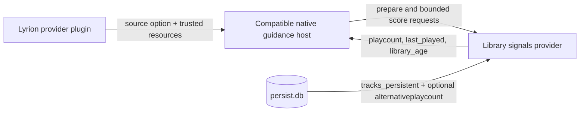

# bliss-guidance-library-signals

`bliss-guidance-library-signals` is an optional
[Bliss guidance SPI](https://github.com/chrober/bliss-playlist-guidance-spi)
provider for Lyrion's own listening and library history. It supplies three
small, normalized signals while leaving Bliss as the authority for acoustic
similarity, eligibility, repeat windows, and route validity.

| Channel | Source in Lyrion `persist.db` | What its signed host policy can prefer |
| --- | --- | --- |
| `playcount` | `tracks_persistent.playCount` | less- or more-played tracks |
| `last_played` | `tracks_persistent.lastPlayed` | longer-unheard or recently played tracks |
| `library_age` | `tracks_persistent.added` | older or newer library additions |

When the separately installed Alternative Play Count plugin is enabled, the
Lyrion provider can explicitly select `alternativeplaycount.playCount` and
`alternativeplaycount.lastPlayed` for the first two channels. Library age
always remains sourced from `tracks_persistent.added`. Missing APC rows are
neutral for APC-derived signals rather than being treated as zero plays.

The provider is started by a compatible native guidance host such as
[bliss-playlist-optimizer](https://github.com/chrober/bliss-playlist-optimizer),
not by Lyrion directly. The separately installed
[Lyrion provider plugin](https://github.com/chrober/lms-guidance-library-signals)
supplies a trusted, read-only `persist.db` descriptor and the frozen eligible
candidate identities. The provider does not require Alternative Play Count
(APC). APC-specific skip, last-skipped, DPSV, and detailed-history guidance
remains separate future work.

At preparation, the provider verifies the identity artifact, opens one
read-only SQLite snapshot, freezes `as_of_unix_seconds` plus the configured
last-played and library-age horizons, and retains only the play-count
distribution. Date channels use BlissMixerLab's exponential saturation curve:
never played is distinct from an unknown row, future dates are treated as new,
and ages beyond a horizon taper rather than growing without limit. At scoring,
the provider queries only the optimizer's already-admitted shortlist and caches
those job-local results. Rows missing from `tracks_persistent`, and missing or
zero `added` values, remain neutral rather than receiving invented ranks.

See the [SPI contract](https://github.com/chrober/bliss-playlist-guidance-spi)
for the host-neutral JSONL protocol and the optimizer repository for the
host-side orchestration.
